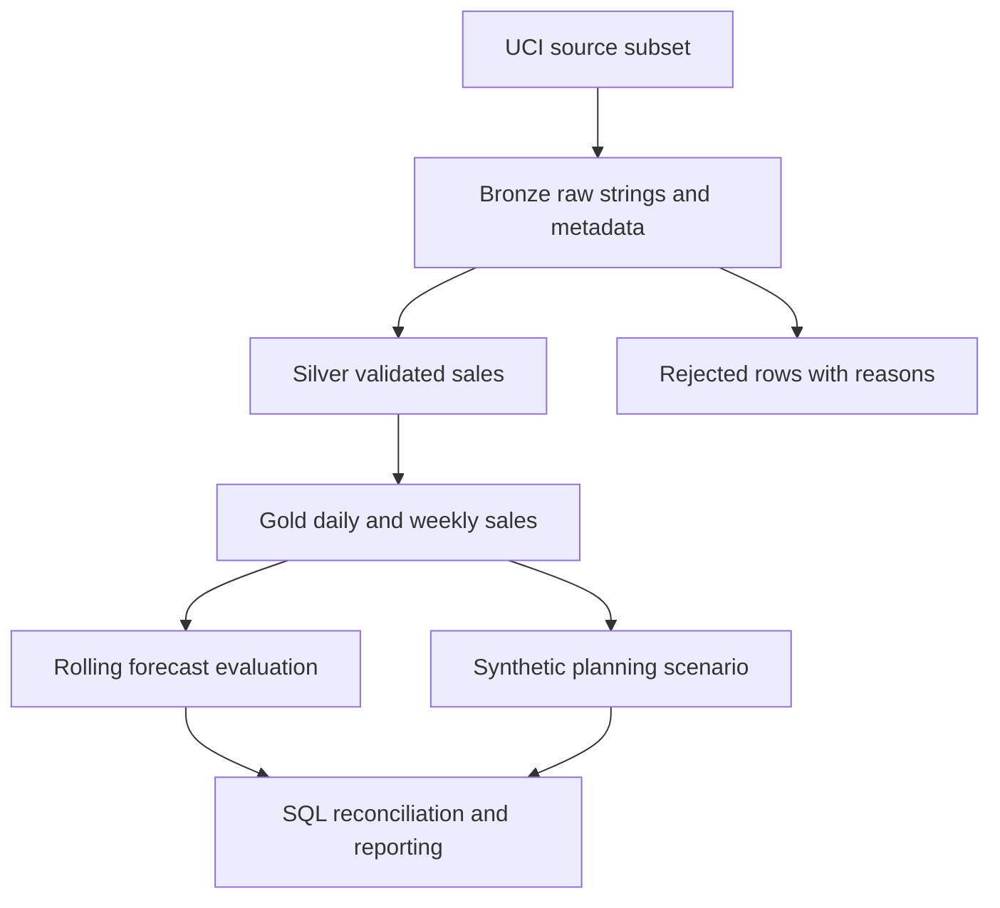

<p align="center"></p>

# SupplySight Analytics
**Manufacturing inventory intelligence and demand forecasting**


An independent final-year analytics engineering project aligned with a supply-chain
internship. **No affiliation with, deployment at, or real stakeholder engagement with Danfoss.**
Public retail sales demonstrate the engineering patterns. All stock, lead-time and
capacity inputs are separately labeled synthetic scenarios.

## What it answers
Which products need replenishment review? Which have excess stock under a scenario?
How much does a simple statistical model improve on baselines? Do source totals,
Gold datasets, SQL controls and workbook formulas agree?

## Executed results
| Evidence | Measured result |
|---|---:|
| Raw subset rows ingested by Spark | 26,058 |
| Accepted / rejected | 24,258 / 1,800 |
| Accepted units, reconciled to Gold | 350,997 |
| Products / daily history | 20 / 365 days |
| Gold datasets / quality rules / KPI reconciliations | 8 / 8 / 14 |
| Rolling origins / equal horizon | 3 / 14 days |
| Synthetic at-risk / overstock products | 8 / 4 |

Test and workbook verification: [verification report](reports/verification.md).
Machine-readable numbers: [evaluation.json](reports/evaluation.json).

## Architecture

PySpark performs ingestion, validation, date-grid expansion and Gold aggregation.
Pandas/scikit-learn handle bounded per-product forecasting, DuckDB independently
reconciles metrics, and Parquet/CSV connect the layers. This dataset does not need
Spark for speed; Spark is chosen to demonstrate transferable ETL engineering.
No speedup or production-scale claim is made.

## Data and license
Chen, D. (2015), [Online Retail](https://archive.ics.uci.edu/dataset/352/online+retail),
UCI, DOI 10.24432/C5BW33, **CC BY 4.0**. [Provenance](data/provenance.json)
records the download URL, source and subset SHA-256 hashes, fields and row counts.
The original workbook contained 541,909 rows. The actual Spark run ingested only
the included 26,058-row subset, not the entire original workbook.
M5 was not used to avoid a competition-account/download dependency.

Twenty products are selected using transaction frequency **before 2011-03-01**.
All their rows are retained in raw, including cancellations and out-of-window dates.
The complete analysis window is 2010-12-01 through 2011-11-30.
Sales are an imperfect proxy for demand: absent transactions are assumed zero,
which may hide stockouts or closures. No observed manufacturing data is claimed.

## Forecasting
| Model | Pooled WAPE | Role |
|---|---:|---|
| Last-value naive | 92.53% | Baseline |
| Seasonal-naive, lag 7 | 99.06% | Prespecified planning baseline |
| Standardized Ridge, alpha 10 | 76.64% | Explainable challenger |

Three expanding training windows precede nonoverlapping 14-day targets. Each
product contributes 42 evaluated days per model. Ridge uses lag 1/7/14, trailing
7/28-day means and day-of-week sin/cos. Future lag features use recursive
predictions only. Scaling is fitted inside each training window. No random splits.

Ridge reduced pooled WAPE by 22.63% relative
to seasonal-naive and improved absolute error for 90%
of products. Its bias was -31.55%, meaning substantial
underforecasting. Absolute errors remain high. Do not treat this as production-ready
forecasting. No model was tuned on these holdouts. Planning uses seasonal-naive
chosen in advance rather than selecting a winner from the reported test results.


WAPE pools absolute error over actual units; it is not the average of product WAPEs.
Zero-total actuals yield undefined WAPE/bias, stored as null. MAPE excludes zero
actuals and is diagnostic only because intermittent sales make it unstable.
Forecast value added is 1 − challenger WAPE / baseline WAPE, on identical rows.

## Inventory and capacity
Seed 52316 creates stock = rounded recent mean × Uniform(2,85) days, lead time =
integer 5–21 days, weekly capacity = max(1, rounded mean × 7 × Uniform(.65,1.5)).
Safety stock = 1.65 × 28-day population std × sqrt(lead days).
Reorder point = forecast daily mean × lead days + safety stock.
Risk means stock < reorder point; overstock means cover >60 days.
The normal independent-demand approximation is illustrative, not calibrated
service-level assurance. On-order stock and receipts are unavailable and excluded.
Capacity is a per-product hypothetical unit limit, not a shared factory bottleneck.
No financial inventory turnover, savings or stockout outcomes are asserted.


## Reporting deliverables
- [Excel workbook](excel/SupplySight_Operations_Analysis.xlsx): seven sheets,
  editable formulas, tables, XLOOKUP descriptions, conditional formatting and native chart.
  [Usage and refresh](docs/EXCEL_GUIDE.md). Artifact-rendered previews are not Excel screenshots.
- [Power BI build kit](powerbi/README.md): typed Power Query, 17 authored measures,
  relationships, three-page design and acceptance checks. **No PBIX or verified pages.**
- Five [Databricks source notebooks](notebooks/), with local functions and manual
  [import steps](docs/DATABRICKS_SETUP.md). **No Databricks runtime claim.**


## Run locally
Prerequisites: Python 3.12, Java 17, approximately 2 GB free memory. No database
server, paid API, cloud credentials or source download needed for the included subset.
```powershell
cd SupplySight-Analytics
py -3.12 -m venv .venv
.\.venv\Scripts\Activate.ps1
python -m pip install -r requirements.txt
python -m supplysight.cli
python -m pytest -q
```
See [Windows setup](docs/WINDOWS_SETUP.md) for Java and troubleshooting.
Rebuild the full-data-derived subset, optionally:
```powershell
python scripts/prepare_source.py
```
The downloader reads the official XLSX using openpyxl only as an input reader.
The workbook was authored using `@oai/artifact-tool`; that builder requires the
ChatGPT artifact runtime. Outside it, use the included workbook and Excel Desktop
COM refresh script. Native Excel refresh is provided but unexecuted here.

## Quality assurance and reproducibility
`pytest` covers bad schemas, bad records, duplicates, source/Gold reconciliation,
hand-calculated KPIs, zero demand, threshold boundaries, leakage via holdout mutation,
chronological horizons, deterministic scenarios, output schemas and cached workbook
results. [CI](.github/workflows/ci.yml) runs local Spark, lint and tests with the
included small subset. Remote Actions is configured but unverified.
Ingestion timestamps vary; business row IDs, transformations and planning values
are deterministic. Writes stage each Spark dataset in a fresh directory and replace the dedicated
output after successful completion (single writer only).

## Documentation
| Reader | Guide |
|---|---|
| Business reviewer | [Requirements](docs/BUSINESS_REQUIREMENTS.md), [stakeholder brief](docs/STAKEHOLDER_BRIEF.md) |
| Analyst | [KPIs](docs/KPI_DEFINITIONS.md), [dictionary](docs/DATA_DICTIONARY.md), [Excel](docs/EXCEL_GUIDE.md) |
| Engineer | [Architecture](docs/ARCHITECTURE.md), [testing](docs/TESTING.md), [decision log](docs/DECISIONS.md) |
| Student | [Interview and resume material](docs/RESUME_AND_INTERVIEW.md) |
| Publisher | [Publishing checklist](docs/PUBLISHING.md), [risks](docs/RISK_REGISTER.md) |

## Limitations and next work
Small selected retail sample, one year, three folds, no demand censoring correction,
no real lead-time distribution or inventory history. Duplicate business rows might
represent genuine repeat lines; rejection is an explicit conservative assumption.
Missing customer IDs are allowed because customer attributes are not used.
First/last weeks are partial and carry days_in_week. Product descriptions may change;
the lexicographically first accepted description is display-only, never a feature.
No Delta dependency is introduced. Gold uses Parquet for portability.
Future work: validate on longer histories, add genuine inventory/receipt data,
calibrate safety stock, compare intermittent-demand methods and verify BI natively.
